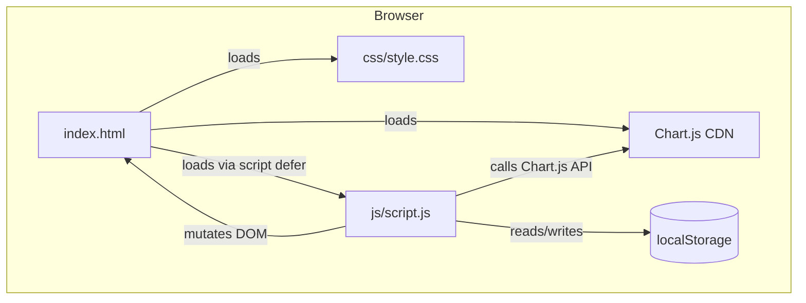

# Design Document — Expense & Budget Visualizer

## Overview

Expense & Budget Visualizer is a purely client-side web application delivered as three files:
`index.html`, `css/style.css`, and `js/script.js`. There is no backend, no build step, and no
JavaScript framework. State lives entirely in memory (a JavaScript array) and is synced to
`localStorage` on every mutation. Chart.js is the only external dependency, loaded via CDN.

### Goals

- Let users record, view, and delete expense transactions.
- Show a running total and a pie chart of spending by category.
- Support dark/light mode, transaction sorting, and overspend-limit highlighting.
- Survive page refresh without data loss using `localStorage`.

### Non-Goals

- No user accounts, authentication, or cloud sync.
- No currency conversion (USD/$ only).
- No budget forecasting or multi-currency support.

---

## Architecture

The application follows a simple **unidirectional data flow**:

```
User Action
    │
    ▼
Validation Layer (validateForm / validateLimit)
    │ valid
    ▼
State Mutation  ──────────────────────────────────────────────────┐
(addTransaction / deleteTransaction / setLimit / setSort / toggle)│
    │                                                              │
    ▼                                                              │
Storage Sync (saveToStorage)                                       │
    │                                                              │
    ▼                                                              │
Render Pass (renderAll)                                            │
  ├─ renderTransactionList()  ◄──────────────────────────────────-┘
  ├─ renderBalance()
  └─ renderPieChart()
```

All rendering is triggered by a single `renderAll()` call after every mutation. There is no
partial re-render — the full list, balance, and chart are always redrawn from the in-memory
state array. This keeps the state-to-UI relationship simple and predictable.

### Technology Stack

| Concern        | Solution                                 |
|----------------|------------------------------------------|
| Markup         | Semantic HTML5 in `index.html`           |
| Styling        | CSS3 custom properties in `css/style.css`|
| Logic          | Vanilla ES6+ in `js/script.js`           |
| Charting       | Chart.js via CDN (`<script>` in `<head>`)|
| Persistence    | `window.localStorage`                    |
| Module system  | None (single IIFE or top-level script)   |

---

## Architecture Diagram



---

## Components and Interfaces

### HTML Structure (`index.html`)

```
<html>                         ← theme class applied here: class="dark"
  <head>
    <script src="Chart.js CDN">
    <script defer src="js/script.js">
    <link rel="stylesheet" href="css/style.css">
  </head>
  <body>
    <header>
      <h1>Expense & Budget Visualizer</h1>
      <button id="theme-toggle">🌙 / ☀️</button>   ← Theme_Toggle
    </header>

    <main>
      <!-- Balance_Display -->
      <section id="balance-section">
        <h2>Total Expenses</h2>
        <p id="balance-display">$0.00</p>
      </section>

      <!-- Input_Form -->
      <section id="form-section">
        <form id="transaction-form">
          <input  id="item-name"  type="text"   maxlength="100" required>
          <input  id="amount"     type="number" min="0.01" max="999999999.99" step="0.01" required>
          <select id="category"   required>
            <option value="">Select category</option>
            <option value="Food">Food</option>
            <option value="Transport">Transport</option>
            <option value="Fun">Fun</option>
          </select>
          <button type="submit">Add Transaction</button>
        </form>
        <div id="form-errors" role="alert" aria-live="polite"></div>
      </section>

      <!-- Sort_Control + Limit_Input -->
      <section id="controls-section">
        <label for="sort-select">Sort by:</label>
        <select id="sort-select">
          <option value="none">— None (chronological) —</option>
          <option value="amount-asc">Amount ↑</option>
          <option value="amount-desc">Amount ↓</option>
          <option value="category-asc">Category A–Z</option>
        </select>

        <label for="limit-input">Highlight limit ($):</label>
        <input id="limit-input" type="number" min="0" step="0.01" placeholder="0.00">
        <div id="limit-error" role="alert" aria-live="polite"></div>
      </section>

      <!-- Transaction_List -->
      <section id="list-section">
        <h2>Transactions</h2>
        <ul id="transaction-list"></ul>
        <p id="empty-state" hidden>No transactions recorded yet.</p>
      </section>

      <!-- Pie_Chart -->
      <section id="chart-section">
        <h2>Spending by Category</h2>
        <canvas id="pie-chart"></canvas>
        <p id="chart-empty" hidden>No data available.</p>
      </section>
    </main>
  </body>
</html>
```

No `<style>` blocks or inline `style` attributes appear anywhere in the HTML file.

### CSS Architecture (`css/style.css`)

The theme system is **class-based on `<html>`**. Default (no class) = light mode.
Adding `class="dark"` to `<html>` switches to dark mode via CSS custom properties.

```css
/* Light mode defaults */
:root {
  --color-bg:         #ffffff;
  --color-surface:    #f5f5f5;
  --color-text:       #1a1a1a;
  --color-text-muted: #555555;
  --color-accent:     #3b82f6;
  --color-border:     #e0e0e0;
  --color-highlight:  #fef3c7;   /* overspend highlight background */
  --color-highlight-border: #f59e0b;
}

/* Dark mode overrides */
html.dark {
  --color-bg:         #121212;
  --color-surface:    #1e1e1e;
  --color-text:       #f0f0f0;
  --color-text-muted: #aaaaaa;
  --color-accent:     #60a5fa;
  --color-border:     #333333;
  --color-highlight:  #451a03;
  --color-highlight-border: #f59e0b;
}
```

All component styles reference only these custom properties, so a single class toggle on
`<html>` switches the entire theme with zero JavaScript DOM traversal.

The `.over-limit` class is applied to transaction list items whose amount exceeds the limit:

```css
li.over-limit {
  background-color: var(--color-highlight);
  border-left: 4px solid var(--color-highlight-border);
}
```

Responsive layout uses CSS Grid/Flexbox with `min-width` media queries:
- `< 600px`: single-column stack (mobile-first base styles)
- `≥ 600px`: two-column form fields
- `≥ 900px`: side-by-side list and chart

### JavaScript Module Breakdown (`js/script.js`)

The script is a single file with logically grouped sections (not ES modules, to avoid CORS
issues when opened via `file://`):

```
js/script.js
│
├── [SECTION 0] Theme bootstrap (top-level, runs BEFORE DOMContentLoaded)
│   └── applyThemeFromStorage()
│
├── [SECTION 1] Constants & State
│   ├── STORAGE_KEY_TRANSACTIONS = 'ebv_transactions'
│   ├── STORAGE_KEY_THEME        = 'ebv_theme'
│   ├── STORAGE_KEY_LIMIT        = 'ebv_limit'
│   ├── CATEGORIES               = ['Food', 'Transport', 'Fun']
│   ├── CATEGORY_COLORS          = { Food: '#f87171', Transport: '#60a5fa', Fun: '#4ade80' }
│   ├── let transactions = []     ← in-memory source of truth
│   ├── let currentSort  = 'none'
│   ├── let spendLimit   = null   ← null means "not set"
│   └── let chartInstance = null  ← holds Chart.js instance for destroy/recreate
│
├── [SECTION 2] Storage utilities
│   ├── loadFromStorage()
│   └── saveToStorage()
│
├── [SECTION 3] Validation
│   ├── validateTransactionForm(item, amount, category) → { valid, errors[] }
│   └── validateLimit(value) → { valid, error }
│
├── [SECTION 4] State mutations
│   ├── addTransaction(item, amount, category)
│   └── deleteTransaction(id)
│
├── [SECTION 5] Rendering
│   ├── renderTransactionList()
│   ├── renderBalance()
│   ├── renderPieChart()
│   └── renderAll()
│
├── [SECTION 6] Sort & Limit helpers
│   ├── getSortedTransactions()
│   └── applyLimit()
│
├── [SECTION 7] Theme
│   ├── applyThemeFromStorage()   ← also called in SECTION 0
│   └── toggleTheme()
│
└── [SECTION 8] Event listeners (inside DOMContentLoaded)
    ├── form submit
    ├── transaction list click (delete delegation)
    ├── sort select change
    ├── limit input change
    └── theme toggle click
```

---

## Data Models

### Transaction Object

Each transaction is stored as a plain JavaScript object:

```js
{
  id:        string,   // crypto.randomUUID() or Date.now().toString() fallback
  item:      string,   // 1–100 characters, user-provided
  amount:    number,   // parsed float, stored with full precision (display rounds to 2dp)
  category:  string,   // 'Food' | 'Transport' | 'Fun'
  createdAt: number    // Date.now() timestamp — used for chronological tie-breaking
}
```

### localStorage Keys

| Key                   | Type            | Value                                |
|-----------------------|-----------------|--------------------------------------|
| `ebv_transactions`    | JSON string     | Serialized `Transaction[]` array     |
| `ebv_theme`           | string          | `'dark'` or `'light'`                |
| `ebv_limit`           | string (number) | Numeric string, e.g. `'150.00'`      |

All three keys are namespaced with `ebv_` to avoid collision with other apps.

### Derived State (computed on every render, never stored)

| Derived Value         | Calculation                                      |
|-----------------------|--------------------------------------------------|
| `totalBalance`        | `sum(transactions.map(t => t.amount))` rounded 2dp |
| `categoryTotals`      | `Map<category, sum>` filtered to amount > 0      |
| `sortedTransactions`  | `transactions` sorted by `currentSort` then `createdAt` |
| `highlightedIds`      | `Set<id>` where `t.amount > spendLimit`          |

---

## State Management

### In-Memory State

The single source of truth is the `transactions` array in module scope. No framework
reactivity or Observable pattern is used. After every mutation the sequence is:

1. Mutate `transactions` (push or splice).
2. Call `saveToStorage()` — writes serialized JSON to `localStorage`.
3. Call `renderAll()` — recomputes all derived state and updates the DOM.

This is safe because all operations are synchronous. There is no async state.

### State Initialization Sequence

```
Browser starts parsing index.html
    │
    ├─ Encounters <script src="Chart.js CDN"> → loads Chart.js
    │
    ├─ Encounters <script defer src="js/script.js"> → schedules for after parse
    │
    └─ Finishes parsing HTML
           │
           ▼
   js/script.js top-level code executes
           │
           ├─ [STEP 1] applyThemeFromStorage()
           │      Reads localStorage.getItem('ebv_theme')
           │      Calls: document.documentElement.classList.toggle('dark', theme === 'dark')
           │      ← This runs BEFORE DOMContentLoaded, preventing flash of wrong theme
           │
           └─ DOMContentLoaded listener registered
                      │
                      ▼  (fires when DOM is ready)
                [STEP 2] Cache DOM element references
                [STEP 3] loadFromStorage()
                         ├─ Parse transactions JSON → populate transactions[]
                         ├─ Parse limit → set spendLimit
                         └─ (theme already applied in STEP 1)
                [STEP 4] Attach all event listeners
                [STEP 5] renderAll()
                         ├─ renderTransactionList()
                         ├─ renderBalance()
                         └─ renderPieChart()
```

### Why `defer` Prevents Flash of Wrong Theme

`<script defer>` delays execution until HTML parsing is complete but runs **before**
`DOMContentLoaded` fires. The top-level code in `script.js` (outside any event listener)
executes as soon as the parser finishes. Since `applyThemeFromStorage()` is at the top of
the file outside any `DOMContentLoaded` listener, it runs at that moment and sets the
`dark` class on `<html>` before the browser performs its first paint of the page body.

The implementation:

```js
// script.js — FIRST lines of the file (no wrapping function)
(function applyThemeFromStorage() {
  const saved = localStorage.getItem('ebv_theme');
  document.documentElement.classList.toggle('dark', saved === 'dark');
})();
```

---

## Theme System

### Toggle Behavior

```js
function toggleTheme() {
  const isDark = document.documentElement.classList.toggle('dark');
  localStorage.setItem('ebv_theme', isDark ? 'dark' : 'light');
  // No re-render needed: CSS custom properties cascade automatically
}
```

The toggle adds or removes `class="dark"` on `<html>`. Because all colors are defined as
CSS custom properties that differ between `:root` and `html.dark`, the entire UI updates
via CSS cascade with no JavaScript DOM traversal.

### WCAG AA Compliance

Color pairs in both themes are chosen to meet the 4.5:1 contrast ratio requirement:
- `--color-text` on `--color-bg`: ≥ 7:1 (both modes)
- `--color-text` on `--color-surface`: ≥ 5:1 (both modes)
- `--color-highlight` text on `--color-highlight`: verified per theme

---

## Chart Update Strategy

The chart uses a **destroy and recreate** approach rather than `chart.update()`:

```js
function renderPieChart() {
  if (chartInstance) {
    chartInstance.destroy();
    chartInstance = null;
  }

  const totals = computeCategoryTotals(); // only amounts > 0
  const canvas = document.getElementById('pie-chart');
  const emptyMsg = document.getElementById('chart-empty');

  if (totals.size === 0) {
    canvas.hidden = true;
    emptyMsg.hidden = false;
    return;
  }

  canvas.hidden = false;
  emptyMsg.hidden = true;

  chartInstance = new Chart(canvas, {
    type: 'pie',
    data: {
      labels: [...totals.keys()],
      datasets: [{
        data: [...totals.values()],
        backgroundColor: [...totals.keys()].map(c => CATEGORY_COLORS[c])
      }]
    },
    options: {
      plugins: {
        legend: { position: 'bottom' }
      }
    }
  });
}
```

**Rationale for destroy/recreate over `chart.update()`**: The transaction list can change
categories present (a category may disappear entirely), so the labels array itself changes
structure. Recreating avoids Chart.js animation state bugs when the label count changes.
The performance cost is negligible for the data volumes involved.

---

## Sort Implementation

```js
function getSortedTransactions() {
  const list = [...transactions]; // never mutate the source array

  if (currentSort === 'none') return list; // already in insertion (chronological) order

  list.sort((a, b) => {
    let primary = 0;
    if (currentSort === 'amount-asc')  primary = a.amount - b.amount;
    if (currentSort === 'amount-desc') primary = b.amount - a.amount;
    if (currentSort === 'category-asc')
      primary = a.category.toLowerCase().localeCompare(b.category.toLowerCase());

    // Tie-break: chronological order (earliest first)
    return primary !== 0 ? primary : a.createdAt - b.createdAt;
  });

  return list;
}
```

The source `transactions` array always preserves insertion order (new items appended).
`getSortedTransactions()` returns a sorted copy for rendering only.

---

## Limit / Highlight Implementation

```js
function applyLimit(listItem, transaction) {
  const active = spendLimit !== null && spendLimit > 0;
  const over   = active && transaction.amount > spendLimit;
  listItem.classList.toggle('over-limit', over);
}
```

`spendLimit` is `null` when the field is empty, and `0` triggers no highlight (per
Requirement 10.5). Any positive numeric value activates highlighting for transactions
whose amount strictly exceeds it.

Limit validation runs on the `input` event (real-time feedback):

```js
limitInput.addEventListener('input', () => {
  const raw = limitInput.value.trim();
  if (raw === '' || parseFloat(raw) === 0) {
    spendLimit = null;
    clearLimitError();
  } else if (isNaN(parseFloat(raw))) {
    showLimitError('Please enter a valid number.');
    spendLimit = null;
  } else {
    spendLimit = parseFloat(raw);
    clearLimitError();
    localStorage.setItem('ebv_limit', raw);
  }
  renderAll();
});
```

---

## Correctness Properties

*A property is a characteristic or behavior that should hold true across all valid executions
of a system — essentially, a formal statement about what the system should do. Properties
serve as the bridge between human-readable specifications and machine-verifiable correctness
guarantees.*

---

### Property 1: Valid submission adds exactly one transaction

*For any* valid transaction input (item name: non-empty string ≤ 100 characters, amount:
between 0.01 and 999,999,999.99, category: one of Food/Transport/Fun), submitting the form
must result in the transaction list length increasing by exactly 1 and the new transaction
appearing in the list with the correct item name, amount, and category.

**Validates: Requirements 1.2**

---

### Property 2: Invalid input is rejected without modifying state

*For any* form submission where at least one field is invalid — empty item name, empty or
missing category, amount less than 0.01, amount with value 0 or negative, or item name
longer than 100 characters — the transaction list must remain unchanged (same length and
contents as before the submission) and at least one validation error message must be
visible to the user.

**Validates: Requirements 1.3, 1.4, 1.6**

---

### Property 3: Form resets to default state after every successful add

*For any* successful transaction submission, after the transaction is added the item name
field must equal `""`, the amount field must equal `""`, and the category select must show
its default unselected placeholder option.

**Validates: Requirements 1.5**

---

### Property 4: Every transaction is rendered with all required fields in correct format

*For any* non-empty transaction list, every rendered list item must contain the transaction's
item name, the amount formatted as `$X.XX` (two decimal places, leading `$` sign), the
category label (Food, Transport, or Fun), and a delete button. No rendered item may be
missing any of these four elements.

**Validates: Requirements 2.1**

---

### Property 5: Deleting a transaction removes exactly that transaction

*For any* transaction list with at least one entry, clicking the delete button for any
transaction must result in that transaction no longer appearing in the rendered list, the
list length decreasing by exactly 1, and all other transactions remaining unaffected.

**Validates: Requirements 2.3**

---

### Property 6: Balance always equals the rounded sum of all transaction amounts

*For any* state of the transaction list (including empty, single entry, or many entries),
the value displayed in Balance_Display must equal `$` followed by the sum of all transaction
amounts rounded to exactly 2 decimal places using standard half-up rounding. An empty list
must display `$0.00`. This property must hold immediately after every add and every delete.

**Validates: Requirements 3.1, 3.2, 3.3, 3.4, 3.5**

---

### Property 7: Pie chart segment proportions match category totals

*For any* transaction list containing only transactions with amounts greater than 0, each
category present in the list must have a pie chart segment whose proportion (as a percentage
of total amount) equals that category's sum divided by the sum of all amounts, multiplied by
100, rounded to two decimal places. Categories with no transactions must not appear as
segments. After every add or delete the pie chart data must reflect the updated totals.

**Validates: Requirements 4.1, 4.3**

---

### Property 8: Zero and negative amount transactions are excluded from the pie chart

*For any* transaction with an amount of zero or less, that transaction must contribute
exactly 0 to its category's total in all pie chart calculations and must not cause a segment
to be rendered for that category if it is the only transaction in that category.

**Validates: Requirements 4.6**

---

### Property 9: localStorage always mirrors the current transaction list

*For any* sequence of add and delete operations, the value of
`JSON.parse(localStorage.getItem('ebv_transactions'))` immediately after each operation must
be an array whose length, order, and entries exactly match the in-memory `transactions`
array. On app re-initialization with that stored data, the rendered list, balance, and pie
chart must reflect the stored transactions.

**Validates: Requirements 5.1, 5.2, 5.3**

---

### Property 10: Sort order invariant holds for all transactions and all sort modes

*For any* list of transactions and any active sort mode, the rendered order must satisfy
the sort predicate:
- `amount-asc`: each item's amount ≤ the next item's amount.
- `amount-desc`: each item's amount ≥ the next item's amount.
- `category-asc`: each item's category is ≤ the next item's category (case-insensitive
  lexicographic order).
- `none`: items appear in chronological insertion order.

For any two adjacent transactions with equal sort keys, the one with the earlier `createdAt`
timestamp must appear first. This invariant must hold immediately after any new transaction
is added while a sort mode is active.

**Validates: Requirements 9.2, 9.3, 9.4**

---

### Property 11: Transactions with amount > limit are highlighted; all others are not

*For any* valid limit value > 0, every transaction in the rendered list whose amount is
strictly greater than the limit must have the `over-limit` CSS class applied, and every
transaction whose amount is ≤ the limit must not have that class. When the limit is changed
to any new valid value, the highlight state of all transactions must be re-evaluated and
updated within 100 milliseconds. When the limit is empty or 0, no transaction must have
the `over-limit` class.

**Validates: Requirements 10.2, 10.3, 10.5**

---

### Property 12: Theme state is toggled and persisted correctly

*For any* starting theme state (light or dark), activating the Theme_Toggle must switch the
`dark` class on `<html>` to the opposite state (add if absent, remove if present), and
`localStorage.getItem('ebv_theme')` must immediately equal `'dark'` or `'light'` matching
the new state. On app re-initialization with a saved theme value, the top-of-script code
must apply the corresponding class to `<html>` before `DOMContentLoaded` fires, with no
flash of the wrong theme.

**Validates: Requirements 8.2, 8.3, 8.5**

---

### Property 13: Limit value is persisted and restored on initialization

*For any* valid limit value set by the user, `localStorage.getItem('ebv_limit')` must equal
the string representation of that value. On app re-initialization, the limit input field
must display that persisted value and the highlight state of all loaded transactions must
reflect it.

**Validates: Requirements 10.6**

---

## Error Handling

### Validation Errors (user input)

| Condition                             | Response                                                                 |
|---------------------------------------|--------------------------------------------------------------------------|
| Empty item name                       | Show error in `#form-errors`; do not add transaction; do not reset form  |
| Item name > 100 characters            | Show error in `#form-errors`; do not add transaction                     |
| Amount < 0.01 or not a number         | Show error in `#form-errors`; do not add transaction                     |
| Category not selected                 | Show error in `#form-errors`; do not add transaction                     |
| Limit input contains non-numeric text | Show error in `#limit-error`; clear `spendLimit`; remove all highlights  |

Errors are cleared when the user makes a new valid submission or corrects the field.

### Storage Errors

| Condition                               | Response                                                                       |
|-----------------------------------------|--------------------------------------------------------------------------------|
| `localStorage.setItem` throws           | Catch the exception; show a non-blocking warning toast; keep in-memory state   |
| `localStorage.getItem` returns invalid JSON | Catch `SyntaxError`; initialize with empty array; show non-blocking warning |
| `localStorage.getItem` returns non-array | Check `Array.isArray`; initialize with empty array; show non-blocking warning  |

All storage errors are non-blocking: the app continues to function in-memory for the
current session. The delete operation cannot truly "fail" in a client-side app outside of
storage errors — the `transactions` array mutation always succeeds.

### Chart Errors

If `chartInstance.destroy()` throws (e.g., Chart.js not loaded), the error is caught and
logged. The canvas is cleared by setting `chartInstance = null` and the render continues.
An `<p id="chart-empty">` fallback message is always shown when no data is available.

---

## Testing Strategy

### Overview

This feature is a vanilla JavaScript single-page application. The appropriate testing tools
are:

- **Property-based tests**: [fast-check](https://github.com/dubzzz/fast-check) (JavaScript,
  browser-compatible, no build required via CDN or Node test runner)
- **Unit tests**: [Vitest](https://vitest.dev/) or Jest for pure logic functions
- **Integration / smoke tests**: Manual testing checklist + Playwright for cross-browser
  automation (Requirements 6.x)

### Pure Logic Under Test

The following functions contain logic that is decoupled from the DOM and testable in
isolation:

| Function                    | Testable as   |
|-----------------------------|---------------|
| `validateTransactionForm()` | Property + Unit |
| `validateLimit()`           | Property + Unit |
| `computeBalance()`          | Property       |
| `computeCategoryTotals()`   | Property       |
| `getSortedTransactions()`   | Property       |
| `applyThemeFromStorage()`   | Property (env mock) |
| JSON serialization round-trip | Property     |
| Highlight predicate `amount > limit` | Property |

### Property-Based Testing with fast-check

Each correctness property maps directly to one property-based test. Tests are configured
to run a minimum of **100 iterations** per property.

Tag format for each test:
`// Feature: expense-budget-visualizer, Property {N}: {property_text}`

Example test skeleton:

```js
import fc from 'fast-check';
import { validateTransactionForm } from '../js/script.js';

// Feature: expense-budget-visualizer, Property 2: Invalid input is rejected without modifying state
test('Property 2: invalid inputs are rejected', () => {
  fc.assert(
    fc.property(
      fc.oneof(
        // empty item
        fc.record({
          item: fc.constant(''),
          amount: fc.float({ min: 0.01, max: 999999999.99 }),
          category: fc.constantFrom('Food', 'Transport', 'Fun')
        }),
        // amount below minimum
        fc.record({
          item: fc.string({ minLength: 1, maxLength: 100 }),
          amount: fc.float({ max: 0.009 }),
          category: fc.constantFrom('Food', 'Transport', 'Fun')
        })
      ),
      ({ item, amount, category }) => {
        const result = validateTransactionForm(item, amount, category);
        return result.valid === false && result.errors.length > 0;
      }
    ),
    { numRuns: 100 }
  );
});
```

### Unit Tests

Focus on concrete examples and edge cases not covered by property generators:

- Empty transaction list → balance is `$0.00`
- Empty transaction list → empty-state message visible
- All transactions deleted → pie chart shows placeholder
- Invalid JSON in localStorage → app initializes empty with warning
- `localStorage.setItem` throws `QuotaExceededError` → warning shown, in-memory state intact
- Theme defaults to light when no preference stored

### Integration / Smoke Tests

Manual checklist (or Playwright script):

1. Open `index.html` in Chrome, Firefox, Edge, Safari — verify all features work.
2. Verify Chart.js CDN `<script>` tag is present in `<head>`.
3. Verify no `<style>` blocks or inline `style` attributes in `index.html`.
4. Verify `<script defer src="js/script.js">` is in `<head>`.
5. Verify theme applies without flash on page reload (DevTools → disable cache → hard reload).
6. Verify responsive layout at 320px, 600px, 900px, 1440px viewport widths.
7. Verify WCAG AA contrast ratios in both light and dark mode using browser DevTools.

### Dual Testing Approach

Property tests and unit tests are complementary:
- Property tests validate universal behavior across a wide input space (catching edge cases
  that specific examples miss).
- Unit tests validate specific concrete scenarios and error conditions.
- Together they provide comprehensive coverage for the pure logic layer without needing
  end-to-end tests for every scenario.
